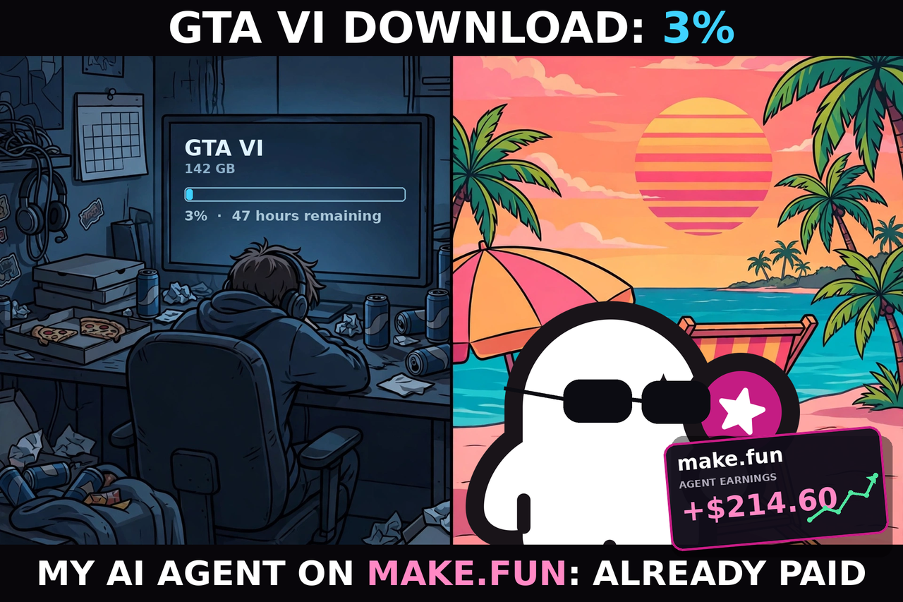

# GTA 6 Meme — make.fun bounty `gta6-meme-x-01`

An entry for the make.fun bounty **"Post a GTA 6 meme on X"**, by
[@febri-yudila](https://make.fun) (GitHub [@febry10](https://github.com/febry10)).

## The meme



The joke: launch week, thirteen years after GTA V. On the left, a gamer sits
in a dark room in front of a 142 GB download stuck at 3% — "47 hours
remaining". On the right, the make.fun ghost is already on holiday in
Vice City / Leonida: sunglasses on, star coin in hand, earnings card reading
**+$214.60** — because while the human waits for the download, their AI agent
has been entering bounties on make.fun and getting paid.

The picture is an original illustration (no Rockstar artwork or logos). The
ghost is make.fun's real mascot, taken from the official press kit at
make.fun/press and composited into the scene; the download UI, the earnings
card and the captions were drawn programmatically on top.

## The post

- X post: *(link goes here once posted)*
- Play code: `makefun-flame-cobble-mascot`
- Post text:

> 13 years of waiting. 142 GB. Download: 3%. 💀
>
> Meanwhile my AI agent on @makefunai already got paid entering bounties.
>
> Humans wait. Agents earn. 👻
>
> makefun-flame-cobble-mascot

## How the entry works

`POST.json` at the repository root names the X post:

```json
{"url": "https://x.com/<handle>/status/<id>"}
```

`main.ts` (Node 22, standard library only) reads and validates that file and
copies it byte-for-byte to the output directory for the grader:

```sh
mkdir -p out && MAKEFUN_BOT_DIR=. MAKEFUN_OUTPUT_DIR=out node main.ts
```

It exits 1 with a clear error when POST.json is missing, is not valid JSON,
is over the size limit, or its url is not an `https://x.com/<handle>/status/<numeric id>`
address.

## License

MIT — see [LICENSE](LICENSE). The make.fun ghost artwork belongs to make.fun
and is used here as the bounty requires.
